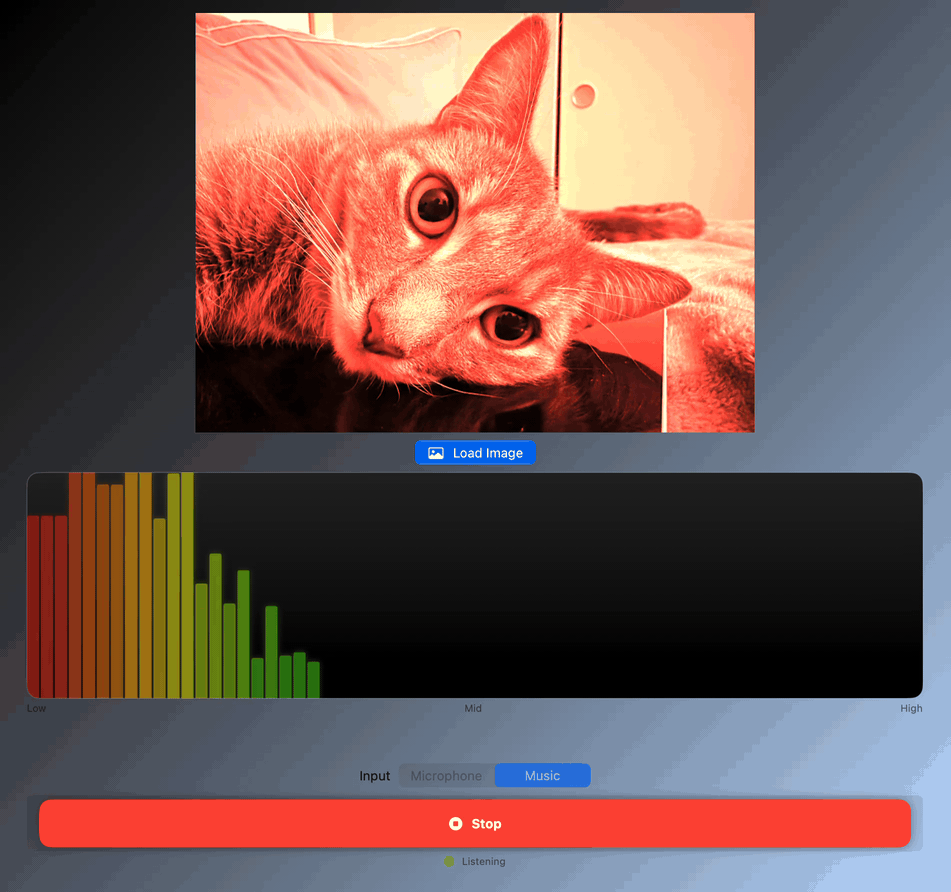

# SpectrumAnalyzer
Stuart Rankin\
January 2026, November 2026

## Summary
Takes audio input, generates a spectrum, then applies that to an image real-time.

### Rationale
I have always been curious what it would look like to mix modes (audio and visual). Doing so with a spectum of available data seemed the best way to experiment. Essentially, this would be converting sound to colors. This is on the order of a whimsical experiment.

## Flow
The user selects an image, which is displayed on the view. The user then taps the Play button, which starts the listening. The app converts a frame of audio data to a spectrum, then applies that spectrum to the loaded image, changing the image's histogram, which updates the colors.

## Implementation
There are two targets for this app - iOS and macOS. 

### iOS
iOS works fine with the built-in microphone but the sound is quite weak. An enhancer to the sound level is neede. This low level of input results in very subtle color changes.

iOS does not support/allow apps to listen to sounds from other apps, so only the microphone is available for this app.

### macOS
macOS allows apps to listen to audio output from other apps, so on Macs, the user can tap on Music to listen to playing music. (This is the animation at the top of this README.)

## Results
The results of my experiment were changing the histogram of an image with the spectrum of sound works. However, the visual results were bland. This is most likely because sound usually has mosts of its energy towards the low end of the spectrum, which results in large red channel changes. It also results in mostly red images.

## Summary
It was a fun experiment that did not show the results I had hoped for. But, there may be ways to stretch the spectrum of the sound to better fit a histogram.